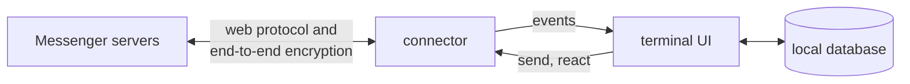

<p align="center">
  
</p>

<h1 align="center">tuon</h1>

<p align="center">
  Messenger in your terminal: your chats, sorted into folders, and nothing else.<br>
  <em>Tuon</em> is Tagalog for "focus".
</p>

<p align="center">
  
  
  
</p>

<p align="center">
  
</p>

Messenger's apps are heavy and built to keep you scrolling. Tuon keeps only the conversations: no feed, stories, ads or suggestions. It runs in a terminal window, uses about 40 MB of memory, and sorts your chats into folders like Work and Personal, so family and work stay apart.

It's a personal tool that talks to Messenger the unofficial way. Read [Before you use it](#before-you-use-it) first.

## What you get

- **Folders** you name and order yourself. New chats land in Inbox until you file them, and an **Unread** tab gathers every unread chat in one place.
- **Encrypted 1:1 and group chats**, sending and receiving, including replies, @mentions, reactions and files.
- **Real photos** in Ghostty, kitty and WezTerm. Other terminals show a `View photo` button that opens the photo in your viewer, with several photos opening as a gallery.
- **Files** people send you save to your Downloads folder with one key. Tuon never opens or runs them.
- **Keyboard first**, with the mouse working too: click a chat to open it, click a photo to view it, drag over messages to copy them.
- **Quiet by default.** One soft sound for new messages, which you can change or turn off, and no "seen" receipts sent back.

<p align="center">
  
</p>

## Install

**macOS** needs [Go](https://go.dev) and [Homebrew](https://brew.sh):

```sh
git clone git@github.com:ralphlagumen/tuon.git
cd tuon
./install.sh
```

This builds `tuon` into `~/.local/bin`, installs [Ghostty](https://ghostty.org) (the terminal that shows real photos) if you don't have it, then runs `tuon setup`: you log in, and can enter your Messenger PIN to bring back older encrypted chats.

**Updating:** run `tuon update`. It pulls the latest changes into the folder you installed from and rebuilds `tuon` in place. Restart tuon afterwards if it was open.

**Linux:** `./install.sh` works the same, minus Ghostty. For photos, use kitty, Ghostty or WezTerm. For copy and paste, install `wl-clipboard` (Wayland) or `xclip` (X11).

**Windows:** build it, then run it in Windows Terminal:

```powershell
go build -o tuon.exe ./cmd/tuon
.\tuon.exe
```

## Log in

`./install.sh` runs `tuon setup` for you (or run `tuon` the first time). It asks how you want to log in:

| Option | What happens |
|---|---|
| **1. Browser window** (recommended) | A browser window opens at Facebook's login page; Messenger uses your Facebook account. Check the address bar shows `https://www.facebook.com`, then log in as usual, including 2-factor. Tuon picks up your session and closes the window. |
| 2. Email and password | Typed into Tuon. This is the Messenger app's own login, and it asks for a 2-factor code if your account needs one. |
| 3. Paste cookies | For when the other two don't work. |

The browser window uses a separate, temporary profile, so your usual browser and its logins aren't touched. Tuon never stores your password, only the session Meta gives back, and keeps it in your system keychain.

Encrypted chats start empty on a new device. Setup asks for your 6-digit Messenger PIN to load their older messages; you can skip it and run `tuon history` later, with Tuon closed.

When Messenger logs you out, Tuon asks you to log in again right away. `tuon logout` forgets your session on this computer, and `tuon logout --wipe` also deletes your chats, folders and encryption keys.

## Use it

The chat list is on the left and the open chat on the right. Press `?` in Tuon for every key.

<details open>
<summary><b>Chat list</b></summary>

| Key | Does |
|---|---|
| `↑` `↓` | Browse chats. The right pane previews each one without marking it read. |
| `enter` | Open the chat, ready to type |
| `←` `→` or `1`–`9` | Switch folders |
| `u` | Jump to Unread |
| `/` | Search chats in every folder, and people. Pick a person and press `enter` to message them. |
| `t` | Move the chat to a folder |
| `f` | Add, rename, delete or reorder folders (`m` picks a folder up, `↑` `↓` moves it) |
| `q` | Quit |

</details>

<details open>
<summary><b>Inside a chat</b></summary>

| Key | Does |
|---|---|
| `enter` | Send |
| `alt+enter` or `ctrl+j` | New line (Terminal.app needs "Use Option as Meta key" for `option+enter`) |
| `@` | Tag someone; `tab` picks |
| `@~/` | Attach a file; the path completes as you type |
| `ctrl+v` | Paste an image, or a file copied in Finder |
| `ctrl+o` | Open the newest photo |
| `↑` on an empty box | Step into the messages |
| `esc` | Back to the chat list, keeping your draft (drafts are kept when you quit too) |

With a message selected:

| Key | Does |
|---|---|
| `enter` | Reply to it |
| `r`, then `1`–`6` | React ❤ 😆 😮 😢 😠 👍 (the same key again removes it) |
| `o` | Open its photo or link, or save its file to Downloads |
| `y` | Copy it |
| `enter` / `d` on a "not sent" message | Send it again / delete it |

</details>

Attached files appear in your text as `[Image #1]` or `[File #2]`. Delete the token to drop the file. Your message shows right away as "sending…", and as "not sent" if Messenger hasn't confirmed it after 45 seconds. If sending fails, your text (and any files not sent) go back in the box.

Type `:` in the chat list for commands: `:mute`, `:sound` (pick the new-message sound and volume), `:images off`, `:quit`.

## Performance


| Measure | tuon |
|---|---|
| Memory, idle after sync | 30 MB (42 MB resident) |
| CPU, idle | under 1% |
| Redraws while idle | none, apart from a backup check every few minutes while an encrypted message is still loading |
| Photos downloaded when opening a chat in Terminal.app | 0 (on click) |
| Program size | 29 MB, one file |

Measured on an M-series Mac on 2026-11-05, with the same account, after the first sync (memory with macOS `footprint`, CPU with `top`). The Chrome figure adds up every Chrome process for one messenger.com tab, left idle for 30 seconds.

## How it works



The **connector** speaks Messenger's protocol through [mautrix-meta](https://github.com/mautrix/meta), the library behind [Beeper](https://www.beeper.com), with whatsmeow handling encrypted chats. It turns everything into plain events: chats, messages, reactions, people. The **UI** saves those to a small SQLite database and draws from it. Other chat apps (Slack, Google Chat) can plug in as more connectors.

## Before you use it

- **Meta's terms.** Messenger has no official API for personal accounts, so Tuon uses the same unofficial route as Beeper. That breaks Meta's terms, and Meta could ask you to verify your account or lock it. Use it on your own account, at your own risk.
- **Linked device.** For encrypted chats, Tuon registers as one of your devices, so you may get a "new login" notice. You can remove it in Messenger's security settings.
- **Security.** [SECURITY.md](SECURITY.md) covers how Tuon protects your login and data, and what it can't protect.

## Known gaps

- Older encrypted messages need your Messenger PIN: run `tuon history` once (with Tuon closed). Tuon uses the PIN to join Messenger's encrypted backup and doesn't keep it. Messenger allows only a few wrong tries.
- Read state isn't sent back to Messenger, so your phone still shows chats you read in Tuon as unread.
- Videos and voice messages show as tags. Open them on your phone.
- Encrypted messages that fail to decrypt show as "loading from your backup" until your phone backs them up, usually within minutes.

## Files

| Where | What |
|---|---|
| System keychain, item "tuon" | Your session (or `~/.config/tuon/login.json`, owner-only, if there's no keychain) |
| `~/.config/tuon/tuon.db` | Chats, folders, drafts, the newest 1,000 messages per chat, encryption keys |
| `~/.config/tuon/tuon.log` | Warnings and errors; starts over past 5 MB |
| `~/.config/tuon/cache/img/` | Photo cache for Ghostty, kitty and WezTerm; photos unused for 2 weeks are removed, capped at 100 MB |

Everything in `~/.config/tuon` is readable only by you.

## Development

```sh
go build -o bin/tuon ./cmd/tuon      # build
go test ./...                        # tests, no network

TUON_LIVE=1 go test ./internal/ui -run TestLive -v               # read-only check on your account
TUON_DOCS=docs/img go test ./internal/ui -run TestDocsScreenshots # redraw the README screenshots
```

```
cmd/tuon/                       entry: login, logout, startup
internal/auth/                  saved login: keychain, browser login
internal/connector/             what a chat platform must provide
internal/connector/messenger/   Messenger through mautrix-meta and whatsmeow
internal/store/                 SQLite: chats, folders, messages, reactions
internal/ui/                    the terminal interface
```

See [CONTRIBUTING.md](CONTRIBUTING.md) to help out.

## License

Copyright (C) 2026 Ralph Lagumen. Tuon is free software under the [GNU Affero General Public License v3.0](LICENSE), and comes with no warranty.
