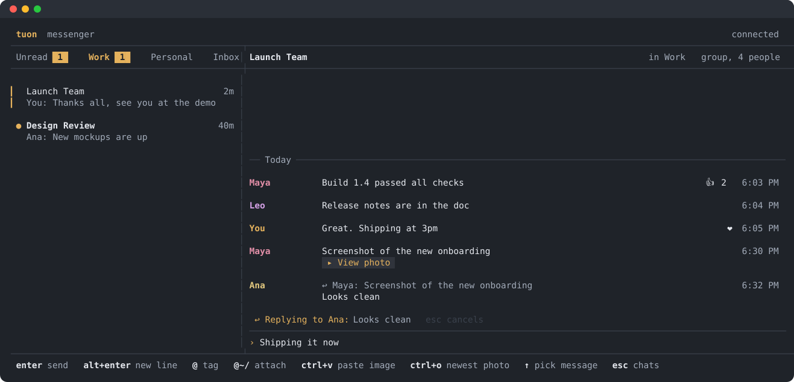
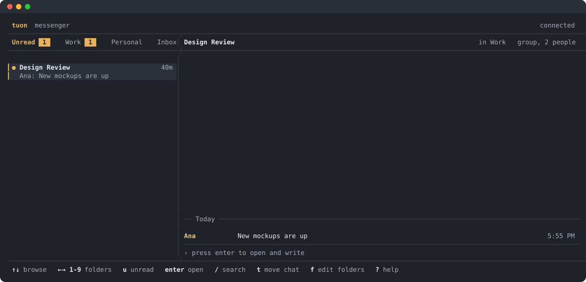
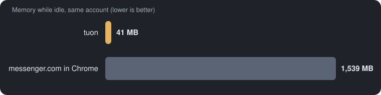
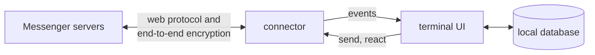

<p align="center">
  
</p>

<h1 align="center">tuon</h1>

<p align="center">
  A lightweight terminal client for Facebook Messenger: your chats, sorted into folders, and nothing else.<br>
  <em>Tuon</em> (said <em>too-OHN</em>) is Tagalog for "focus".
</p>

<p align="center">
  
  
  
</p>

<p align="center">
  
</p>

Messenger's apps are heavy and built to keep you scrolling. Tuon keeps only the conversations: no feed, stories, ads or suggestions. It runs in a terminal window, uses about 40 MB of memory, and sorts your chats into folders like Work and Personal, so family and work stay apart.

It's a personal tool that talks to Messenger the unofficial way. Read [Before you use it](#before-you-use-it) first.

## What you get

- **Folders** you name and order yourself. New chats land in Inbox until you file them, and an **Unread** tab gathers every unread chat in one place.
- **Encrypted 1:1 and group chats**, sending and receiving, including replies, @mentions, reactions and files.
- **Real photos** in Ghostty, kitty and WezTerm. Other terminals show a `View photo` button that opens the photo in your viewer, with several photos opening as a gallery.
- **Files** people send you save to your Downloads folder with one key. Tuon never opens or runs them.
- **Keyboard first**, with the mouse working too: click a chat to open it, click a photo to view it, drag over any text (a message or your draft) to highlight and copy it, double-click for a word, triple-click for a line.
- **Quiet by default.** One soft sound for new messages, which you can change or turn off.
- **Read on every device.** A chat you open in tuon shows as read on your phone and the web, and people see you've seen their messages. `:seen off` keeps your reading private (then your phone still shows those chats unread).
- **Locked and encrypted.** Opening tuon asks for Touch ID (or a passphrase off macOS), it locks itself when idle, and your session, messages and keys are encrypted on disk. On macOS the chat app runs in a sandbox that keeps it away from common secret stores. See [SECURITY.md](SECURITY.md), including what it doesn't protect yet.

<p align="center">
  
</p>

## Install

**macOS** needs [Go](https://go.dev) and [Homebrew](https://brew.sh):

```sh
git clone git@github.com:ralphlagumen/tuon.git
cd tuon
./install.sh
```

This builds `tuon`, its chat app `tuon-app` and its small Touch ID helper (`tuon-keyhelper`, which needs Apple's command line tools: `xcode-select --install`) into `~/.local/bin`, installs [Ghostty](https://ghostty.org) (the terminal that shows real photos) if you don't have it, then runs `tuon setup`.

**Updating:** run `tuon update`. It downloads tuon fresh from GitHub into a temporary folder, installs the newest release tag signed by tuon's maintainer and skips anything unsigned, shows what changed, and asks before building if the update changes tuon's dependencies. Restart tuon afterwards if it was open. Coming from 0.3.0, run `tuon update` twice: the first run installs the new launcher, the second adds the chat app (`tuon-app`) next to it.

**Linux:** `./install.sh` works the same, minus Ghostty. For photos, use kitty, Ghostty or WezTerm. For copy and paste, install `wl-clipboard` (Wayland) or `xclip` (X11).

**Windows:** build it, then run it in Windows Terminal:

```powershell
go build -o tuon.exe ./cmd/tuon
go build -o tuon-app.exe ./cmd/tuon-app
.\tuon.exe
```

## Log in

`./install.sh` runs `tuon setup` for you (or run `tuon` the first time). Setup turns on the lock (Touch ID on a Mac, a passphrase elsewhere), then asks how you want to log in:

| Option | What happens |
|---|---|
| **1. Browser window** (recommended) | A browser window opens at Facebook's login page; Messenger uses your Facebook account. Check the address bar shows `https://www.facebook.com`, then log in as usual, including 2-factor. Tuon picks up your session and closes the window. |
| 2. Email and password | Typed into Tuon. This is the Messenger app's own login, and it asks for a 2-factor code if your account needs one. |
| 3. Paste cookies | For when the other two don't work. |

The browser window uses tuon's own profile, so your usual browser and its logins aren't touched. That profile is kept between logins, so Facebook recognizes the device and you can add your password manager's extension to it once; `tuon logout` deletes it. Tuon never stores your password, only the session Meta gives back, encrypted with tuon's own key.

Encrypted chats start empty on a new device, so right after you log in, setup asks for your 6-digit Messenger PIN to load their older messages (typed or pasted). You can skip it and run `tuon history` later, with tuon closed.

When Messenger logs you out, tuon asks you to log in again right away. `tuon logout` forgets your session on this computer (and the login window's browser profile), and `tuon logout --wipe` also deletes your chats, folders and encryption keys.

## Use it

The chat list is on the left and the open chat on the right. Press `?` in Tuon for every key.

<details open>
<summary><b>Chat list</b></summary>

| Key | Does |
|---|---|
| `↑` `↓` | Browse chats. The right pane previews each one without marking it read. |
| `enter` | Open the chat, ready to type |
| `←` `→` or `1`–`9` | Switch folders |
| `u` | Jump to Unread |
| `/` | Search chats in every folder, and people. Pick a person and press `enter` to message them. |
| `t` | Move the chat to a folder |
| `f` | Add, rename, delete or reorder folders (`m` picks a folder up, `↑` `↓` moves it) |
| `q` | Quit |

</details>

<details open>
<summary><b>Inside a chat</b></summary>

| Key | Does |
|---|---|
| `enter` | Send |
| `alt+enter` or `ctrl+j` | New line (Terminal.app needs "Use Option as Meta key" for `option+enter`) |
| `@` | Tag someone; `tab` picks |
| `@~/` | Attach a file; the path completes as you type |
| `ctrl+v` | Paste an image, or a file copied in Finder |
| `ctrl+o` | Open the newest photo |
| `↑` on an empty box | Step into the messages |
| `esc` `esc` | Clear the box (one `esc` on an empty box goes back to the chat list) |
| `tab` | Back to the chat list, keeping your draft (drafts are kept when you quit too) |

With a message selected:

| Key | Does |
|---|---|
| `enter` | Reply to it |
| `r`, then `1`–`6` | React ❤ 😆 😮 😢 😠 👍 (the same key again removes it) |
| `o` | Open its photo or link, or save its file to Downloads |
| `y` | Copy it |
| `enter` / `d` on a "not sent" message | Send it again / delete it |

</details>

Attached files appear in your text as `[Image #1]` or `[File #2]`. Delete the token to drop the file. Your message shows right away as "sending…", and as "not sent" if Messenger hasn't confirmed it after 45 seconds. If sending fails, your text (and any files not sent) go back in the box.

Type `:` in the chat list for commands, or just their first letter: `:mute` (`:m`), `:sound` (`:s`: pick the new-message sound and volume; `:s off` turns it off), `:images off` (`:i off`), `:previews off` (`:p off`: no message text in the chat list, for when someone can see your screen), `:seen off` (`:r off`: stop marking chats read on Messenger), `:lock` (`:l`; tuon also locks after 10 minutes idle), `:help` (`:h`), `:quit` (`:q`).

From your shell:

| Command | Does |
|---|---|
| `tuon` | Open tuon |
| `tuon setup` / `tuon login` | Log in (and restore older encrypted chats with your PIN); `tuon login` then opens tuon |
| `tuon history` | Restore older encrypted chats with your PIN |
| `tuon update` | Install the newest signed release |
| `tuon relink` | Register tuon again as a new linked device, if one contact's messages keep failing to decrypt |
| `tuon logout [--wipe]` | Forget your session (`--wipe`: and all local data) |
| `tuon version` | Which release you have (`dev` when built from a checkout that isn't a release tag) |

## Performance



| Measure | tuon |
|---|---|
| Memory, idle | 27 MB: launcher 4 MB + chat app 23 MB (41 MB resident) |
| CPU, idle | under 1% |
| Redraws while idle | none, apart from a backup check every few minutes while an encrypted message is still loading |
| Photos downloaded when opening a chat in Terminal.app | 0 (on click) |
| Program size | launcher 3.4 MB, chat app 31 MB, Touch ID helper 63 KB |

Memory and CPU measured on an M-series Mac with macOS `footprint` and `ps`, with the same account: tuon on 2026-11-09 (both programs, resident memory, sandboxed, a few minutes after start), Chrome on 2026-11-05. The Chrome figure adds up every Chrome process for one messenger.com tab, left idle for 30 seconds.

## How it works



The **connector** speaks Messenger's protocol through [mautrix-meta](https://github.com/mautrix/meta), the library behind [Beeper](https://www.beeper.com), with whatsmeow handling encrypted chats. It turns everything into plain events: chats, messages, reactions, people. The **UI** saves those to a small SQLite database and draws from it. Other chat apps (Slack, Google Chat) can plug in as more connectors.

## Before you use it

- **Meta's terms.** Messenger has no official API for personal accounts, so Tuon uses the same unofficial route as Beeper. That breaks Meta's terms, and Meta could ask you to verify your account or lock it. Use it on your own account, at your own risk.
- **Linked device.** For encrypted chats, tuon registers as one of your devices, so you may get a "new login" notice. You can remove it in Messenger's security settings. Careful: removing tuon's *login* there also logs tuon out.
- **Security.** [SECURITY.md](SECURITY.md) covers how Tuon protects your login and data, and what it can't protect.

## Known gaps

- Older encrypted messages need your Messenger PIN (setup asks; or `tuon history` later). Tuon uses the PIN to join Messenger's encrypted backup and doesn't keep it. Messenger allows only a few wrong tries.
- Videos and voice messages show as tags. Open them on your phone.
- Messenger refuses some file types (such as .zip) in chats that aren't end-to-end encrypted, on messenger.com too; tuon says so instead of sending.
- Encrypted messages that fail to decrypt show as "loading from your backup" until your phone backs them up, usually within seconds to minutes. If one person's messages keep failing, tuon says so and suggests `tuon relink`.
- The sandbox is macOS only for now.

## Files

| Where | What |
|---|---|
| `~/.config/tuon/vault.json` | tuon's key, wrapped by your Mac's Secure Enclave (or your passphrase): useless on its own |
| `~/.config/tuon/login.enc` | Your session, encrypted |
| `~/.config/tuon/tuon.db` | Chats, folders, contacts, the newest 1,000 messages per chat: the whole file encrypted page by page, message text sealed again inside it |
| `~/.config/tuon/keys.db` | Keys for encrypted chats, encrypted page by page |
| `~/.config/tuon/tuon.log` | Warnings and errors; starts over past 5 MB |
| `~/Library/Caches/tuon/browser` | The login window's own browser profile (macOS; `~/.cache/tuon` on Linux), kept between logins; `tuon logout` deletes it |

Everything in `~/.config/tuon` is readable only by you.

## Development

```sh
for c in tuon tuon-app; do CGO_ENABLED=0 go build -trimpath -buildvcs=false -ldflags "-s -w -buildid=" -o bin/$c ./cmd/$c; done   # build (same flags as releases)
./scripts/check.sh            # checksums, build, vet, tests, known vulnerabilities: run before every push
./scripts/deps-review.sh      # after changing a dependency (see DEPENDENCIES.md)
git tag -s v1.2.3 -m v1.2.3 && git push origin v1.2.3   # sign and push the release tag (maintainer key)
./scripts/release.sh v1.2.3   # build a signed tag for every platform (tuon and tuon-app), with SHA256SUMS
gh release create v1.2.3 dist/v1.2.3/* --verify-tag --notes-file notes.md   # publish (notes: that version's CHANGELOG section)

TUON_DOCS=docs/img go test ./internal/ui -run TestDocsScreenshots   # redraw the README screenshots
```

```
cmd/tuon/                       the small launcher: unlock, login browser, update (no Messenger code)
cmd/tuon-app/                   the chat app (sandboxed on macOS): login, setup, history, relink
cmd/tuon-keyhelper/             Swift helper for the Secure Enclave / Touch ID
internal/vault/                 tuon's key: Touch ID or passphrase, encryption
internal/keystore/              encrypted keys.db for encrypted-chat keys
internal/sandbox/               macOS sandbox for the chat app
internal/auth/                  the saved session
internal/browserlogin/          the login browser window (used by the launcher)
internal/opener/                what the sandboxed app asks the launcher to open or paste
internal/paths/                 tuon's folders and the one-tuon-at-a-time lock
internal/connector/             what a chat platform must provide
internal/connector/messenger/   Messenger through mautrix-meta and whatsmeow
internal/store/                 SQLite: chats, folders, messages, reactions
internal/ui/                    the terminal interface
```

See [CONTRIBUTING.md](CONTRIBUTING.md) to help out.

## License

Copyright (C) 2026 Ralph Lagumen. Tuon is free software under the [GNU Affero General Public License v3.0](LICENSE), and comes with no warranty.
